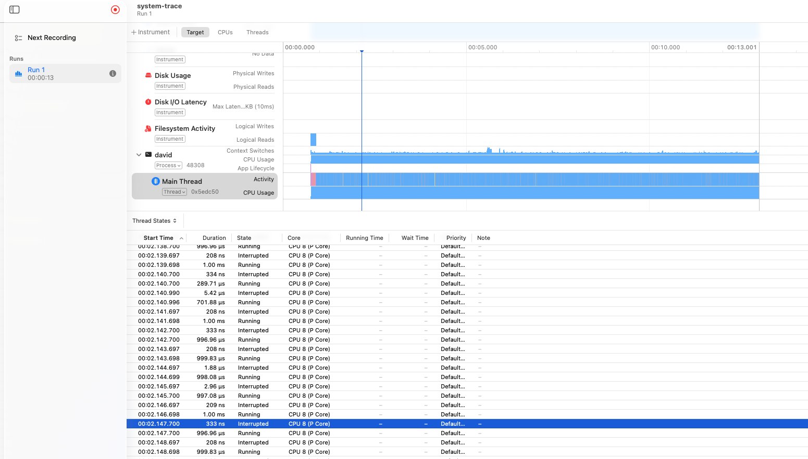
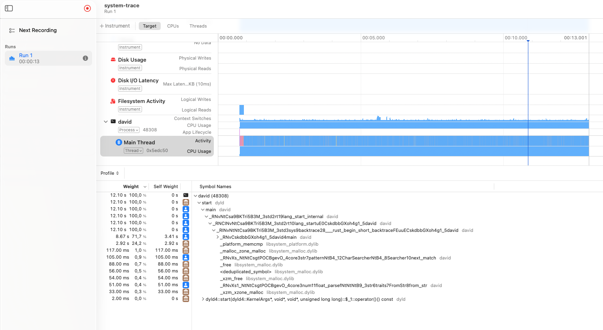

# Part 001 — The first naive version

**Dates:** 2026-10-15 – 2026-10-20
**Video progress:** stopped at [38:38](https://www.youtube.com/watch?v=tCY7p6dVAGE&t=2318s) when this part was published

## Thank you, Jon

Before anything else, a big thank you to [Jon Gjengset](https://github.com/jonhoo) for making
[this video](https://youtu.be/tCY7p6dVAGE). I'm still near the beginning of it, and it already gives me something no
tutorial does: learning Rust in practice, watching how Jon writes the code and how he thinks
about it as he goes. And I love the positive energy he puts into it: you can see he really
enjoys it.

Nothing in these notes is meant as judging Jon's code against mine. I compare the two only
to learn Rust, and to help others who want to learn it in a similar way.

## Goal

### The challenge

The [One Billion Row Challenge](https://github.com/gunnarmorling/1brc) (1BRC): read a text
file with one billion temperature measurements and compute the min, mean and max for every
weather station, as fast as possible.

The input has one measurement per line:

```text
Oklahoma City;-1.0
Charlotte;18.1
Philadelphia;11.3
```

The output is one line per station, sorted alphabetically, as `station=min/mean/max`
rounded to one decimal place:

```text
Abha=-27.7/18.0/61.0
Abidjan=-18.7/26.0/71.0
Abéché=-14.9/29.4/76.3
```

**How the official challenge was measured.** The
[1BRC README](https://github.com/gunnarmorling/1brc#evaluating-results) says:

> *"Results are determined by running the program on a Hetzner AX161 dedicated server
> (32 core AMD EPYC™ 7502P (Zen2), 128 GB RAM)."*
>
> *"Programs are run from a RAM disk (i.o. the IO overhead for loading the file from disk is
> not relevant), using 8 cores of the machine."*

Each entry ran 5 times with `hyperfine`. The fastest and slowest runs were dropped, and the
result is the mean of the other three. The best entries finished in ~1.5 s on 8 cores
(1.535 s) and ~0.3 s on all 32 cores / 64 threads (0.323 s). So the official times measure
**CPU and RAM only**, never the disk.

### My goal

I'm learning Rust, so the challenge is a vehicle, not the target. I follow
[Jon's stream](https://youtu.be/tCY7p6dVAGE), write
my own version next to his, and on top of that I want to **see how the code works with the
hardware**: CPU cores and caches, memory, swap and the SSD. That's why each part measures more
than just the time, and why [My machine](#my-machine) describes the laptop in detail.

For this part: write the simplest program that produces correct output. Speed doesn't
matter yet. This version is the **baseline** that every later optimization gets measured
against.

That's also why this part spends more time on the measuring setup than on the code. I'm
building and trying out the tools now (the measuring script, the RAM disk, Instruments
traces and a small tool to analyze them), so that in the later parts I can just run them
and focus on the optimizations.

I work with three input files of growing size:

| File                          | Rows          | Size      | Used for                                       |
|-------------------------------|---------------|-----------|------------------------------------------------|
| `input/1M_measurements.txt`   | 1,000,000     | ~13.8 MB  | Day-to-day iteration: runs in under a second    |
| `input/100M_measurements.txt` | 100,000,000   | ~1.38 GB  | A realistic check that still runs in seconds    |
| `input/1B_measurements.txt`   | 1,000,000,000 | ~13.8 GB  | The real challenge, run at the end of each part |

All three have the same 413 stations. My laptop is not very powerful, so I iterate on the
small files and run the 1B file only once a version is finished.

With the 1B file I can't copy the official setup. The file is 13.8 GB and my laptop has
16 GB of RAM, so it never fits in RAM next to everything else. It always has to be read from
the SSD, and that alone takes ~6 s (see [Storage](#storage-how-fast-can-the-file-be-read)).
That's why I measure two things:

- **1M and 100M from RAM.** These files fit, so before measuring I copy them into RAM.
  The program doesn't touch the SSD at all, which is the closest I get to the official
  setup. It measures how fast the code is. 0.1 s for 100M would be like 1 s for 1B.
- **1B from the SSD.** The real run on my machine, SSD included. It can never go below
  ~6 s.

**Only the 1M file is committed.** GitHub rejects files over 100 MB. The 100M file is
~1.38 GB and the 1B file is ~13.8 GB, and even compressed with `xz` the 1B file would be
roughly 3 GB. To run those two you have to generate them yourself (see
[Setup](#setup-generating-the-input-file)). The 1M file is already in the repo, so you can
try both versions right away, without Java:

```sh
git clone <this repo>
cd brrr
cargo build --release
./target/release/david  input/1M_measurements.txt
./target/release/jonhoo input/1M_measurements.txt
```

## Setup: generating the input file

You only need this for the 100M and 1B files; the 1M file is already committed. They are
generated locally with the official Java generator from
[`gunnarmorling/1brc`](https://github.com/gunnarmorling/1brc).

### 1. Install Java 21

The generator needs JDK 21.

```sh
# Install JDK 21
brew install openjdk@21

# Register it with macOS so the system Java tools can find it (asks for your password)
sudo ln -sfn /opt/homebrew/opt/openjdk@21/libexec/openjdk.jdk \
  /Library/Java/JavaVirtualMachines/openjdk-21.jdk

# Add it to PATH and set JAVA_HOME permanently
echo 'export PATH="/opt/homebrew/opt/openjdk@21/bin:$PATH"' >> ~/.zshrc
echo 'export JAVA_HOME="/opt/homebrew/opt/openjdk@21"' >> ~/.zshrc
source ~/.zshrc
```

Verify:

```console
$ java --version
openjdk 21.0.12.1 2026-08-18
OpenJDK Runtime Environment Homebrew (build 21.0.12.1)
OpenJDK 64-Bit Server VM Homebrew (build 21.0.12.1, mixed mode, sharing)
```

### 2. Clone and build the 1BRC repo

```sh
git clone https://github.com/gunnarmorling/1brc.git
cd 1brc
./mvnw clean verify
```

This builds `target/average-1.0.0-SNAPSHOT.jar`, which contains the generator.

### 3. Generate the measurements

The argument is the number of rows. The generator always writes `measurements.txt` in the
root of the `1brc` repo, so rename the file after each run.

The 1 billion row file:

```console
$ ./create_measurements.sh 1000000000
Wrote 50,000,000 measurements in 8045 ms
Wrote 100,000,000 measurements in 18001 ms
...
Wrote 950,000,000 measurements in 188166 ms
Created file with 1,000,000,000 measurements in 198260 ms
```

It took **~3 min 18 s** and wrote **13,795,468,189 bytes ≈ 13.8 GB**. Make sure there is
enough free disk space first.

Verify the result:

```console
$ ls -lh measurements.txt
-rw-r--r--@ 1 davidhruby  staff    13G Oct 16 00:01 measurements.txt

$ wc -l measurements.txt
 1000000000 measurements.txt
```

`ls -h` shows `13G` because it counts in binary units: 13,795,468,189 B ÷ 1024³ ≈ 12.85 GiB,
rounded up. `wc -l` reading the whole file took ~11 s. That gives a rough reference for how
long it takes just to read the file and scan it for newlines, before any parsing.

Rename it so the next run doesn't overwrite it:

```sh
mv measurements.txt 1B_measurements.txt
```

The smaller files work the same way:

```sh
./create_measurements.sh 1000000
mv measurements.txt 1M_measurements.txt

./create_measurements.sh 100000000
mv measurements.txt 100M_measurements.txt
```

`create_measurements.sh` is a thin wrapper around:

```sh
java --class-path target/average-1.0.0-SNAPSHOT.jar dev.morling.onebrc.CreateMeasurements <rows>
```

The rows are random, so each generated file has different content. When you compare
outputs between implementations, always run both on the **same** file.

### 4. Use it from this repo

Move the generated files into `input/` in the `brrr` repo:

```sh
mv path/to/1brc/100M_measurements.txt path/to/1brc/1B_measurements.txt path/to/brrr/input/
```

A move within the same disk is instant, because the file is not copied.

`input/100M_measurements.txt` and `input/1B_measurements.txt` are listed in `.gitignore`, so
they are never committed.

## My machine

| | |
|---|---|
| Model | MacBook Air (Mac16,12) |
| Chip | Apple M4, 10 cores (4 performance + 6 efficiency) |
| RAM | 16 GB |
| Storage | 256 GB NVMe SSD (`APPLE SSD AP0256Z`), reads ~2.3 GB/s |
| OS | macOS 26.6 |
| Rust | `rustc 1.97.1` |

### CPU and cache layout

Cores of the same type are grouped into a **cluster**. Each core has its own L1 cache,
and all cores in a cluster share one L2 cache (and one clock frequency).

| | Performance cores (P) | Efficiency cores (E) |
|---|---|---|
| Cores | 4 | 6 |
| L1 instruction cache (per core) | 192 KB | 128 KB |
| L1 data cache (per core) | 128 KB | 64 KB |
| L2 cache (shared per cluster) | 16 MB | 4 MB |
| Cores sharing one L2 | 4 (whole P-cluster) | 6 (whole E-cluster) |

```text
Apple M4
├── P-cluster
│   ├── P0: own L1 ┐
│   ├── P1: own L1 ├── shared L2 (16 MB)
│   ├── P2: own L1 │
│   └── P3: own L1 ┘
├── E-cluster
│   └── E0…E5: each own L1 ── shared L2 (4 MB)
│
├── SLC (System Level Cache): shared by the whole chip (CPU, GPU, …)
└── RAM 16 GB (unified memory)
```

The **SLC (System Level Cache)** is the last cache level before RAM. Unlike L1 and L2 it
doesn't belong to the CPU but to the whole chip: both CPU clusters, the GPU, the Neural
Engine and the rest share it:

```text
P-cluster (L2)   E-cluster (L2)   GPU   Neural Engine   …
       \               |           |          /
        └──────────────┴─── SLC ───┴─────────┘
                             │
                     RAM (unified memory)
```

Apple doesn't publish its size (reports say ~8 MB for the base M4), and `sysctl` doesn't
show it.

Apple Silicon has no hyperthreading (`logicalcpu` = `physicalcpu`), so one core runs one
thread at a time. macOS decides which core a thread runs on and can move it between
P and E cores while it runs.

#### Clock frequency

Apple doesn't publish the clock speeds, and `sysctl` doesn't show them on Apple Silicon.
Reviews report roughly **4.4 GHz for the P-cores** and **2.9 GHz for the E-cores**. The real
frequency changes with load and temperature, and the MacBook Air has no fan, so it may slow
down under a long load.

Frequency matters because it ties the counters from `/usr/bin/time -l` to time:

```text
CPU time      = CPU cycles / CPU frequency
IPC           = instructions / CPU cycles
```

- **CPU cycles** (`cycles elapsed`): how many clock ticks the CPU spent on the program, in
  total for the whole run.
- **CPU frequency**: how many ticks the CPU does per second, e.g. 4 GHz = 4 billion.
- **CPU time** (`user` + `sys`): how long the program was actually running on a core. Not
  the wall time: while the program waits (e.g. for swap), the CPU isn't ticking for it.
- **Instructions** (`instructions retired`): how many machine instructions the program
  executed in total. One line of Rust can be one instruction or thousands.
- **IPC** (instructions per cycle): how much work gets done per tick.

A single-threaded program that lands on an E-core runs slower even with the same code, so
the frequency also tells me whether a comparison between two runs is fair. The frequency
of each cluster, second by second, is shown by:

```sh
sudo powermetrics --samplers cpu_power -i 1000
```

What frequency my runs actually got is in
[Measurements](#which-cores-did-it-run-on).

<details>
<summary>Raw output of <code>sysctl hw.perflevel0 hw.perflevel1</code></summary>

```text
hw.perflevel0.physicalcpu: 4
hw.perflevel0.physicalcpu_max: 4
hw.perflevel0.logicalcpu: 4
hw.perflevel0.logicalcpu_max: 4
hw.perflevel0.l1icachesize: 196608
hw.perflevel0.l1dcachesize: 131072
hw.perflevel0.l2cachesize: 16777216
hw.perflevel0.cpusperl2: 4
hw.perflevel0.name: Performance
hw.perflevel1.physicalcpu: 6
hw.perflevel1.physicalcpu_max: 6
hw.perflevel1.logicalcpu: 6
hw.perflevel1.logicalcpu_max: 6
hw.perflevel1.l1icachesize: 131072
hw.perflevel1.l1dcachesize: 65536
hw.perflevel1.l2cachesize: 4194304
hw.perflevel1.cpusperl2: 6
hw.perflevel1.name: Efficiency
```

</details>

### Storage: how fast can the file be read?

| | |
|---|---|
| SSD | `APPLE SSD AP0256Z`, internal NVMe (`disk0`), 251 GB raw |
| Main volume | `Macintosh HD`, APFS, 245 GB |
| TRIM | Yes |

(From `system_profiler SPNVMeDataType`.)

**Why the SSD matters here, but not in the official challenge.** The official 1BRC runs read
the file from RAM on a server with 128 GB (see [The challenge](#the-challenge)), so the speed
of the disk plays no role there. On my laptop it does, for two reasons:

1. **The 1B file is always read from the SSD.** 13.8 GB doesn't fit into my 16 GB of RAM next
   to everything else, so every 1B run has to read the whole file from the SSD, even a
   version that uses almost no memory. This sets a floor for every version of the program.
2. **A version that holds too much in memory also swaps.** If the program keeps more data
   in memory than fits (like my `read_to_string` version, which keeps the whole 13.8 GB
   file), macOS moves memory out to the SSD and back again. Then the SSD is busy with swap
   on top of reading the file (see [1B over time](#1b-over-time)). A version that streams the
   file doesn't need to swap, so this part can be avoided by better code. The first one
   can't.

Before any parsing, the program has to get the bytes from the SSD into memory. To find that
ceiling I read the input files with `cat` into `/dev/null`, which reads and does nothing
else.

macOS keeps a copy of recently read files in free RAM, so that reading them again doesn't
have to go to the SSD. This part of RAM is called the **file cache** (in Activity Monitor
it's *Cached Files*). `sudo purge` empties it, so the first read below really comes from
the SSD ("cold"). The second read follows right after it ("warm") and can come from RAM.

| File | Size | Cold read (after `sudo purge`) | Second read right after |
|---|---|---|---|
| 100M | 1.38 GB | 0.62 s ≈ **2.2 GB/s** (SSD) | 0.11 s ≈ **12.5 GB/s** (from RAM, the file cache) |
| 1B | 13.8 GB | 6.06 s ≈ **2.3 GB/s** (SSD) | 5.96 s ≈ **2.3 GB/s** (still SSD!) |

What this shows:

- **My SSD reads about 2.2–2.3 GB/s.** Bigger reads don't help: `dd` with 16 MB blocks
  gives the same speed (`dd if=input/1B_measurements.txt of=/dev/null bs=16m` →
  13,795,468,189 bytes in 5.93 s = **2.32 GB/s**). Reading in parallel doesn't help either:
  [`fio`](https://github.com/axboe/fio) with 4 jobs, each reading its own 3 GB part of the
  file with 8 requests in flight and the cache bypassed, reads 12 GiB in 6.01 s =
  **2.14 GB/s** (see the raw output below). Apple doesn't publish SSD speeds, so ~2.3 GB/s is
  the measured ceiling of this SSD. No program can process the 1B file faster than
  ~6 s on this machine unless the file is already in RAM.
- **The 100M file stays in RAM after the first read, the 1B file doesn't.** After one read,
  macOS keeps the 1.38 GB file in the file cache, and the second read is ~5.6× faster. The
  13.8 GB file doesn't fit into RAM next to everything else in 16 GB. Reading it from start
  to end pushes its own beginning out of RAM before it reaches the end, so the next read
  starts from the SSD again.
- **So 100M benchmarks are "warm" unless I purge, and 1B benchmarks are always mostly
  "cold".** To compare runs fairly, I run `sudo purge` before each one (my measuring script
  does that, see [How I measure](#how-i-measure)).
- **Today the SSD isn't the bottleneck.** Jon's version reads the 1B file at only
  13.8 GB / 107 s ≈ 129 MB/s, ~18× below what the SSD can deliver. The time goes to the CPU.
  This changes once the code gets faster.
- **Gotcha:** `/usr/bin/time -l` reports `block input operations 0` even for the cold
  reads that clearly came from the SSD. Like `swaps`, this counter isn't useful on macOS.

<details>
<summary>Raw output of the <code>cat</code> runs</summary>

```text
❯ sudo purge
❯ /usr/bin/time -l cat input/100M_measurements.txt > /dev/null
        0.62 real         0.00 user         0.13 sys
             1409024  maximum resident set size
                   6  page faults
                   0  block input operations
                   9  voluntary context switches
                2634  involuntary context switches
           927445036  instructions retired
           545254834  cycles elapsed

❯ /usr/bin/time -l cat input/100M_measurements.txt > /dev/null
        0.11 real         0.00 user         0.11 sys
             1409024  maximum resident set size
                   1  page faults
                   0  block input operations
                   0  voluntary context switches
                   5  involuntary context switches
           479119606  instructions retired
           372562795  cycles elapsed

❯ sudo purge
❯ /usr/bin/time -l cat input/1B_measurements.txt > /dev/null
        6.06 real         0.02 user         1.21 sys
             1409024  maximum resident set size
                   6  page faults
                   0  block input operations
                 131  voluntary context switches
               28071  involuntary context switches
          9450900425  instructions retired
          5381312692  cycles elapsed

❯ /usr/bin/time -l cat input/1B_measurements.txt > /dev/null
        5.96 real         0.02 user         1.23 sys
             1409024  maximum resident set size
                   5  page faults
                   0  block input operations
                   3  voluntary context switches
               30225  involuntary context switches
          9519953551  instructions retired
          5445595767  cycles elapsed
```

Lines that were zero in every run are left out.

</details>

<details>
<summary>Raw output of the parallel <code>fio</code> read</summary>

```text
❯ sudo purge
❯ fio --name=par4 --filename=input/1B_measurements.txt --readonly \
    --rw=read --bs=1m --ioengine=posixaio --iodepth=8 --numjobs=4 \
    --size=3g --offset_increment=3g --direct=1 --group_reporting
fio-3.43
Starting 4 processes
par4: (groupid=0, jobs=4): err= 0: pid=8766: Sat Oct 17 21:43:01 2026
  read: IOPS=2044, BW=2045MiB/s (2144MB/s)(12.0GiB/6010msec)
    clat (usec): min=1342, max=31423, avg=15587.22, stdev=1023.07
   bw (  MiB/s): min= 1970, max= 2118, per=100.00%, avg=2049.38, stdev=10.46, samples=44
  cpu          : usr=0.09%, sys=1.28%, ctx=51194, majf=0, minf=2086
  IO depths    : 1=0.1%, 2=0.1%, 4=0.1%, 8=99.8%, 16=0.0%, 32=0.0%, >=64=0.0%

Run status group 0 (all jobs):
   READ: bw=2045MiB/s (2144MB/s), 2045MiB/s-2045MiB/s (2144MB/s-2144MB/s), io=12.0GiB (12.9GB), run=6010-6010msec
```

Shortened to the main lines. `--readonly` makes sure fio never writes to the file, and
`--direct=1` bypasses the file cache.

</details>

#### Reading the file from RAM

To see how fast a file can be read once it's in memory, I put the 100M file on a RAM disk
(a disk image that lives in memory) and read it with `dd`:

```sh
diskutil erasevolume APFS RAMDisk $(hdiutil attach -nomount ram://4194304)   # 2 GB RAM disk
cp input/100M_measurements.txt /Volumes/RAMDisk/
dd if=/Volumes/RAMDisk/100M_measurements.txt of=/dev/null bs=16m
hdiutil detach /Volumes/RAMDisk                                               # when done
```

| Read | Time | Speed |
|---|---|---|
| 1st `dd` from the RAM disk | 0.183 s | **7.5 GB/s** |
| 2nd and 3rd `dd` (now also in the file cache) | 0.144 s | **9.6 GB/s** |

So with the file already in RAM, one thread can read it **~4× faster than from the SSD**
(~2.3 GB/s). For the 1B file that would be ~1.4 s instead of ~6 s. On my machine that only
works with the 100M file, because 13.8 GB doesn't fit in RAM twice.

This is the speed of **reading a file** from RAM, not the speed of the RAM itself (the M4's
memory bandwidth is up to 120 GB/s according to Apple). `dd` and `cat` use the `read()`
system call, and for every call the kernel **copies** the data from the file cache into the
program's buffer, on a single thread. Every program that reads the file with `read()`
(including `BufReader`) is limited by this too. Memory mapping (`mmap`) avoids the copy.

Today's code is CPU-bound, so where the bytes come from barely matters yet. I still run the
1M and 100M measurements from the RAM disk: it guarantees the file is in RAM for every run,
and it will matter once the code gets faster.

## Approach

I wrote my own version first and **then** ran Jon's version. Jon's code is there to produce
a known good output that I can check mine against.

The repo has two binaries, `david` and `jonhoo`. Both take the input file as their first
argument, so the same build works with either input. The results go to `output/part001/`,
named after the input size and then the binary, so files for the same size sit next to each other:

```sh
cargo build --release

# 1M
./target/release/david  input/1M_measurements.txt > output/part001/1M_david_output.txt
./target/release/jonhoo input/1M_measurements.txt > output/part001/1M_jonhoo_output.txt
diff output/part001/1M_david_output.txt output/part001/1M_jonhoo_output.txt   # no output = identical

# 100M
./target/release/david  input/100M_measurements.txt > output/part001/100M_david_output.txt
./target/release/jonhoo input/100M_measurements.txt > output/part001/100M_jonhoo_output.txt
diff output/part001/100M_david_output.txt output/part001/100M_jonhoo_output.txt

# 1B
./target/release/david  input/1B_measurements.txt > output/part001/1B_david_output.txt
./target/release/jonhoo input/1B_measurements.txt > output/part001/1B_jonhoo_output.txt
diff output/part001/1B_david_output.txt output/part001/1B_jonhoo_output.txt
```

How I measure time, memory and the rest is in [Measurements](#how-i-measure).

The workflow for each lesson:

1. Write and check the code against the **1M** file. Every run takes under a second.
2. Check it on the **100M** file for more realistic numbers.
3. Run the finished version on the **1B** file once, at the end, to get the real numbers.

The small files have one big blind spot: they fit in RAM easily, so they never show memory
problems. The 1B file is almost as big as my 16 GB of RAM, so any code that loads the whole
file at once gets into trouble there (see [1B over time](#1b-over-time)).
Every version has to **stream** the file to work on both inputs.

## My version

`src/david/main.rs`:

```rust
use std::{collections::BTreeMap, env, fs::read_to_string};

struct MeasurementStats {
    min: f32,
    max: f32,
    sum: f32,
    count: u32
}

fn main() {
    let args: Vec<String> = env::args().collect();
    let input_file_path = &args[1];

    let mut location_to_measurement: BTreeMap<String, MeasurementStats> = BTreeMap::new();
    for line in read_to_string(input_file_path).unwrap().lines() {
        let split = line.split(';').collect::<Vec<&str>>();
        if split.len() == 2 {
            let location = split[0];
            let measurement = &split[1].parse::<f32>().unwrap();

            if location_to_measurement.contains_key(location) {
                let measurement_stats = location_to_measurement.get_mut(location).unwrap();
                if measurement_stats.min > *measurement {
                    measurement_stats.min = *measurement;
                }
                if measurement_stats.max < *measurement {
                    measurement_stats.max = *measurement;
                }
                measurement_stats.sum += measurement;
                measurement_stats.count += 1;
            } else {
                location_to_measurement.insert(location.to_string(), MeasurementStats {
                    min: *measurement,
                    max: *measurement,
                    sum: *measurement,
                    count: 1
                });
            }
        }
    }

    for (location, stats) in location_to_measurement.iter() {
        println!("{}={1:.1}/{2:.1}/{3:.1}", location, stats.min, stats.sum / stats.count as f32, stats.max);
    }
}
```

## Jon's version (reference)

`src/jonhoo/main.rs`. This is the very first version Jon wrote on the stream, from his
first commit
[`jonhoo/brrr@9d0c5ab`](https://github.com/jonhoo/brrr/commit/9d0c5ab5559b33528af685411ccf726746b632b1).
He wrote it on purpose as the simplest correct starting point: a baseline that the rest of
the stream then makes faster step by step. It's not meant to be fast yet, and neither is
mine. I use it with two small changes:

- It takes the input file path as the first command-line argument instead of a hardcoded
  `measurements.txt`, so the same binary works with both input files.
- It prints one station per line instead of the official `{a=…, b=…}` format. That way the
  output can be diffed line by line against mine.

```rust
use std::{collections::BTreeMap, env, fs::File, io::{BufRead, BufReader}};

fn main() {
    let args: Vec<String> = env::args().collect();
    let input_file_path = &args[1];

    let f = File::open(input_file_path).unwrap();
    let f = BufReader::new(f);
    let mut stats = BTreeMap::<String, (f64, f64, usize, f64)>::new();
    for line in f.lines() {
        let line = line.unwrap();
        let (station, temperature) = line.split_once(';').unwrap();
        let temperature: f64 = temperature.parse().unwrap();
        let stats = stats
            .entry(station.to_string())
            .or_insert((f64::MAX, 0., 0, f64::MIN));
        stats.0 = stats.0.min(temperature);
        stats.1 += temperature;
        stats.2 += 1;
        stats.3 = stats.3.max(temperature);
    }
    let mut stats = stats.into_iter().peekable();
    while let Some((station, (min, sum, count, max))) = stats.next() {
        println!("{station}={min:.1}/{:.1}/{max:.1}", sum / (count as f64));
    }
}
```

## Measurements

**Machine:** see [My machine](#my-machine). All runs use a `--release` build and were made with
[`scripts/measure.sh`](../scripts/measure.sh), one run per version and input size. The
totals, the time series and the Instruments trace of the 100M run are from 2026-10-19; the
P-cores vs E-cores runs and the Instruments traces of the 1M run are from 2026-10-18.

### How I measure

`scripts/measure.sh` is a thin wrapper. It only starts standard macOS tools side by side and
saves their raw, unmodified output:

```sh
# a fresh RAM disk with the two small files
diskutil erasevolume APFS RAMDisk $(hdiutil attach -nomount ram://4194304)
cp input/1M_measurements.txt input/100M_measurements.txt /Volumes/RAMDisk/

scripts/measure.sh david 1M part001
scripts/measure.sh jonhoo 1M part001
scripts/measure.sh david 100M part001
scripts/measure.sh jonhoo 100M part001

hdiutil detach /Volumes/RAMDisk        # the 1B run needs the memory
scripts/measure.sh david 1B part001
scripts/measure.sh jonhoo 1B part001
```

> **Gotcha: the RAM disk isn't guaranteed to stay in RAM.** Its memory is ordinary memory, so
> under memory pressure macOS can swap it out to the SSD like any other. Once I ran the 1B
> version of `david` while the RAM disk was still there, and the next 100M run spent its
> first ~4 s reading the "RAM disk" back from swap (~1.5 GB of swap-ins at ~350 MB/s). So:
> create a fresh RAM disk right before the 1M and 100M runs, and do the 1B runs last.

An optional fourth parameter `e-cores` runs the program under `taskpolicy -c background`,
which keeps it on the efficiency cores (see [P-cores vs E-cores](#p-cores-vs-e-cores)).
The results then go into folders and files ending in `_e-cores`.

The 1M and 100M files are read from the RAM disk (see
[Reading the file from RAM](#reading-the-file-from-ram)). The 1B file doesn't fit there, so
it's read from the SSD. Every run starts with `sudo purge`, which empties the file cache, so
a second or third run starts from exactly the same state as the first: the 1B file comes
from the SSD, and the 1M and 100M files only from the RAM disk (not from a cached copy left
by the previous run).

The script writes into `measurements/part001/<size>_<binary>/`:

| File | Tool | What it shows |
|---|---|---|
| `time.txt` | `/usr/bin/time -l` | totals for the whole run |
| `top.txt` | `top -pid …`, every second | the process: CPU %, memory, compressed memory, context switches |
| `vm_stat.txt` | `vm_stat 1` | the whole system: page-ins, compression, swap-ins, swap-outs |
| `iostat.txt` | `iostat -w 1 disk0` | how much goes through the SSD |
| `powermetrics.txt` | `sudo powermetrics --samplers cpu_power -i 1000` | frequency and usage of the P- and E-clusters |
| `memory_before_run.txt`, `memory_after_run.txt` | `memory_pressure`, `sysctl vm.swapusage`, `vm_stat` | memory state before and after |

All raw files are in [`measurements/part001/`](../measurements/part001/). The outputs of both
versions are **identical** on all three files (`diff` prints nothing).

> **Gotcha:** in zsh, `time` is a shell keyword and doesn't accept flags. `time -l ./brrr`
> fails with `command not found: -l`. Use the full path `/usr/bin/time -l` instead.

> **Gotcha:** on macOS, `/usr/bin/time -l` always reports `swaps 0` and
> `block input operations 0`, even when the process swaps a lot or reads from the SSD. The
> kernel doesn't fill in these counters. Use `vm_stat` and `iostat` instead.

### Totals

From `time.txt`:

| Input | Version  | Wall time | User + sys | Peak memory (RSS) | Peak memory footprint | Instr. per row | IPC  |
|-------|----------|-----------|------------|-------------------|-----------------------|----------------|------|
| 1M    | `david`  | 0.15 s    | 0.14 + 0.00 s | **15.6 MB**    | 15.0 MB               | ~2,046         | ~4.0 |
| 1M    | `jonhoo` | 0.13 s    | 0.12 + 0.00 s | **1.8 MB**     | 1.2 MB                | ~1,863         | ~4.2 |
| 100M  | `david`  | 12.54 s   | 12.34 + 0.18 s | **1.38 GB**   | 1.38 GB               | ~2,008         | ~4.0 |
| 100M  | `jonhoo` | 10.62 s   | 10.44 + 0.17 s | **1.9 MB**    | 1.2 MB                | ~1,822         | ~4.3 |
| 1B    | `david`  | **266.1 s** | 120.7 + 15.2 s | **7.2 GB**  | **13.8 GB**           | ~2,165         | ~3.9 |
| 1B    | `jonhoo` | **106.7 s** | 104.7 + 1.8 s  | **1.9 MB**  | 1.2 MB                | ~1,839         | ~4.3 |

Instructions per row = `instructions retired` ÷ rows. IPC (instructions per cycle) =
`instructions retired` ÷ `cycles elapsed`.

What the numbers say:

- **My memory grows with the file, Jon's doesn't.** Mine needs about as much memory as the
  file is big: 15 MB for the 13.8 MB file, 1.38 GB for the 1.38 GB file, 13.8 GB (peak
  footprint) for the 13.8 GB file. That's `read_to_string` loading everything. Jon's stays
  at ~1–2 MB whatever the size.
- **Mine runs ~10 % more instructions per row** (~2,000–2,170 vs ~1,820–1,870), mostly from
  the `Vec` allocated per line and the double map lookup. On 100M that makes mine ~18 %
  slower.
- **On 1B mine is 2.5× slower**, and almost all of that is waiting, not computing: 266.1 s of
  wall time, but only 136 s of CPU time. See [1B over time](#1b-over-time).
- **The cost per row is stable.** Jon's version needs ~1,820–1,870 instructions per row on
  every input size. So the 100M file is a reliable stand-in for the 1B file when comparing
  versions: just multiply the time by ~10.
- **The CPU isn't stalling, it's just doing too much.** An IPC of ~4 is high: the core isn't
  waiting for data, it simply executes ~1,800–2,000 instructions to parse something like
  `Hamburg;12.0`. Making it faster means doing less work per row, not feeding the CPU
  faster.
- **1M is too small to say much.** A run takes ~0.13–0.15 s, and the difference between the
  versions (0.14 vs 0.12 s of user time) is at the resolution of `time`.

### 1M and 100M over time

1M is too short for per-second sampling: `top` didn't catch a single sample. The table is
for 100M:

| | `david` 100M | `jonhoo` 100M |
|---|---|---|
| Memory (`top`) | **1,317 MB** from the first sample on | **~1.1 MB** the whole time |
| Compressed memory (`top` CMPRS) | 0 B | 0 B |
| Swap-ins / swap-outs (`vm_stat`) | 0 / 0 | 0 / 0 |
| CPU (`top`) | ~100 % of one core | ~100 % of one core |
| P-cluster (`powermetrics`) | 100 % active at **4.04–4.06 GHz** | 100 % active at **4.04–4.05 GHz** |
| Context switches (`time -l`, voluntary + involuntary) | 2 + 222 | 2 + 100 |

What the time series show:

- **The SSD isn't involved.** `iostat` shows only background noise (mostly under 30 MB/s).
  The file comes from the RAM disk.
- **Two very different ways to read the same file.** The RAM disk doesn't show up in
  `iostat`, but `vm_stat` counts its pages as *page-ins* (one page = 16 KB) when they're
  read into the file cache:

  | Second | 1 | 2 | 3 | 4 | 5 | 6 | … | 10 |
  |---|---|---|---|---|---|---|---|---|
  | `david` (page-ins) | **85,715** | 1,952 | 4,008 | 53 | 494 | 261 | … | 31 |
  | `jonhoo` (page-ins) | 12,050 | 9,718 | 8,490 | 9,827 | 8,273 | 7,749 | … | 8,485 |

  85,715 × 16 KB ≈ 1.40 GB: mine pulls the whole file into memory in the first second
  (`read_to_string`) and then only computes. Jon's pulls ~7,700–12,000 pages per second
  (~130–200 MB/s) for the whole run, exactly as fast as it processes the rows. That's
  streaming.
- **No memory pressure on 100M.** 1.3 GB fits easily, so there's no compression and no swap
  for either version.
- **Both ran on a P-core the whole time.** The P-cluster was 100 % active at ~4.05–4.1 GHz in
  every sample during the run (see also [Which cores did it run on?](#which-cores-did-it-run-on)).

### P-cores vs E-cores

macOS doesn't let a program choose a specific core. What it does allow is lowering the
priority: a process with the *background* QoS class runs only on the E-cores. So I ran my
version on 100M twice, once normally and once with `taskpolicy -c background`:

```sh
scripts/measure.sh david 100M part001
scripts/measure.sh david 100M part001 e-cores
```

Raw output: [`100M_david/`](../measurements/part001/100M_david/),
[`100M_david_e-cores/`](../measurements/part001/100M_david_e-cores/). The output is identical.

| | Normal (P-cores) | `taskpolicy -c background` (E-cores) | Ratio |
|---|---|---|---|
| Wall time | 12.33 s | **57.04 s** | **4.6×** |
| Instructions | 200.9 billion | 201.1 billion | same |
| CPU cycles | 50.0 billion | 67.0 billion | 1.34× |
| CPU frequency = CPU cycles ÷ CPU time (user + sys) | **4.07 GHz** | **1.18 GHz** | **3.4×** |
| IPC = instructions ÷ CPU cycles | **4.0** | **3.0** | **1.34×** |
| Involuntary context switches | 77 | 3,495 | |

The same code doing the same work gets 4.6× slower, and the slowdown splits cleanly into two
parts:

```text
4.6× = 3.4× (lower clock) × 1.34× (fewer instructions per cycle)
```

- **The clock is only ~1.2 GHz, not the ~2.9 GHz the E-cores can do.** Background QoS doesn't
  just mean "E-cores", it also means "save energy": macOS keeps the E-cluster at a low clock
  for this kind of work. `powermetrics` shows the E-cluster at ~1.1–1.2 GHz almost the whole
  run.
- **The E-cores are narrower.** Fewer execution units and smaller caches (64 KB L1d instead
  of 128 KB, 4 MB L2 instead of 16 MB), so ~25 % fewer instructions per cycle even at the same
  clock.
- **More interruptions.** Background work shares the E-cores with the rest of the system's
  background work, so it gets preempted ~45× more often.

**Did it really stay on the E-cores?** `powermetrics` shows how busy each core was in every
second. The sum over a cluster is ~100 % for the core time my single thread used, plus
whatever else the system was doing:

| Second (sample) | E-cores CPU 0–5, sum | P-cores CPU 6–9, sum |
|---|---|---|
| Normal run, typical second | 9–48 % (background) | **103–114 %** (my thread) |
| E-cores run, typical second | **109–155 %** (my thread) | **2–13 %** (background, almost all on CPU 6) |

In the E-cores run, the E-cluster sum stays at **~110 % or more in every second** of the run
(only the last sample, in which the run ended, is lower), and
the P-cores sit nearly idle: CPU 7–9 at ~0 % most of the time. In a few seconds (e.g. the
3rd, 4th and 18th) the P-cores woke up too, but the E-cluster sum went *up* at the same time
(to 190–240 %), so that was other work on the system, not my thread moving. If my thread had
moved to a P-core, the E-cluster sum would have dropped to the background level.

So yes: under `taskpolicy -c background` the thread stays on the E-cores. It still jumps
between the six E-cores (every second each of them shows some activity), just like it jumps
between the four P-cores in a normal run. Moves within a cluster are cheap, because its cores
share one L2 cache.

#### Exact check with Instruments

`powermetrics` only shows how busy each core was, so the conclusion above is an inference.
Instruments' **System Trace** records every scheduling event: which thread ran on which core,
from when to when. These events aren't sampled: the kernel logs every change with a
nanosecond timestamp, so no move between cores can slip through. I recorded the whole 1M run
(~0.1 s normally, ~0.6 s on the E-cores) and the whole normal 100M run. A trace of the 100M
run on the E-cores (~57 s) would be several hundred MB, so I skipped that one.


```sh
mkdir -p measurements/part001/1M_david_traces
sudo purge
xcrun xctrace record \
  --template 'System Trace' \
  --output measurements/part001/1M_david_traces/system-trace.trace \
  --target-stdout /dev/null \
  --launch -- ./target/release/david /Volumes/RAMDisk/1M_measurements.txt

mkdir -p measurements/part001/1M_david_e-cores_traces
sudo purge
xcrun xctrace record \
  --template 'System Trace' \
  --output measurements/part001/1M_david_e-cores_traces/system-trace.trace \
  --target-stdout /dev/null \
  --launch -- /usr/sbin/taskpolicy -c background ./target/release/david /Volumes/RAMDisk/1M_measurements.txt
```

`xctrace --launch` doesn't search `PATH`, so `taskpolicy` needs its full path. The traces
(7.5 MB and 11 MB) aren't committed (`*.trace` is in `.gitignore`), but anyone can record
their own with the commands above. I read the `cpu-state` table out of each trace with
`xcrun xctrace export --input <trace> --xpath '/trace-toc/run[@number="1"]/data/table[@schema="cpu-state"]'`
and summed up, per core, how long my thread was *Running* there:

| | Normal | `taskpolicy -c background` |
|---|---|---|
| Time running | **0.120 s** | **0.572 s** (4.8× longer) |
| On P-cores | **100 %**, all of it on CPU 8 | 0.3 % (1.5 ms) |
| On E-cores | 0 % | **99.7 %**, spread over CPU 0–5 |
| Running intervals | 171 | 1,201 |
| Moves to another core | **0** | 55 (36 within a cluster, 19 between P and E) |

- **Normally, the whole 0.12 s ran on a single P-core** without moving once. The 171 running
  intervals are short breaks for hardware interrupts, after which the thread came back to the
  same core.
- **On the E-cores, the program's work ran only on E-cores**, but with a small exception
  that `powermetrics` couldn't show: all 1.5 ms on the P-cores happened in the **first ~9 ms**
  after the program started, at the priority *User Interactive – 46* instead of
  *Background – 4*. After that, every running interval was on an E-core at background
  priority. My guess is that this is the start of the process (the kernel loading the program
  after `taskpolicy` hands over to it), which runs at a temporarily raised priority. I haven't
  verified this.
- **More moves on the E-cores** (55 vs 0). Background work shares the E-cores with the rest
  of the system's background work, so the thread gets moved around more.

**The whole 100M run, normal.** The same recording on the 100M file, with every app I didn't
need closed (only the terminal was open), and without touching the Mac during the run. The
trace is 38 MB:

```sh
mkdir -p measurements/part001/100M_david_traces
sudo purge
xcrun xctrace record \
  --template 'System Trace' \
  --output measurements/part001/100M_david_traces/system-trace.trace \
  --target-stdout /dev/null \
  --launch -- ./target/release/david /Volumes/RAMDisk/100M_measurements.txt
```

This time I read the `thread-state` table, which has a *Core* column for every interval of
my thread. I count it with my own small tool,
[`src/analyze/xctrace/`](../src/analyze/xctrace/), in its `cpu_usage` mode:

```sh
xcrun xctrace export --input measurements/part001/100M_david_traces/system-trace.trace \
  --xpath '/trace-toc/run[@number="1"]/data/table[@schema="thread-state"]' > tmp-thread-state-100M.txt
cargo run --release --bin analyze-xctrace -- tmp-thread-state-100M.txt cpu_usage
```

For every *Running* interval it adds the duration to the core it ran on, and it counts a
move whenever the core differs from the previous running interval (and a P↔E move when one
is a P-core and the other an E-core). The XML stores every value only once (`id="…"`) and
later rows only point to it (`ref="…"`), so the tool first collects all definitions and then
looks each row's values up. The result:

| State of my thread | Time | Intervals |
|---|---|---|
| Running | 12.21 s (99.8 %) | 14,915 |
| Blocked (waiting for something) | 0.004 s (~0 %) | 26 |
| Interrupted (hardware interrupts) | 0.03 s (0.2 %) | 14,841 |
| Runnable (ready, but no free core) | ~0 s | 25 |
| Preempted (another thread took the core) | ~0 s | 38 |

| Core | Running time | Share |
|---|---|---|
| CPU 6 (P) | 2.87 s | 23.5 % |
| CPU 7 (P) | 3.15 s | 25.8 % |
| CPU 8 (P) | 3.08 s | 25.2 % |
| CPU 9 (P) | 3.12 s | 25.5 % |
| CPU 0–5 (E) | 0 s | 0 % |

- **All of it ran on the P-cores, not a single microsecond on an E-core.**
- **The thread moves between the P-cores at a steady pace:** 39 moves in 12.2 s, about
  **3 per second**. So it stays on one core for ~⅓ s, and over the whole run the time ends up
  split evenly, ~25 % per P-core. The regular rhythm looks like the scheduler deliberately
  rotating the thread over the cluster, maybe to spread the heat. That's my guess, I haven't
  verified it.
- **The program almost never waited:** 99.8 % of the time it was running. The tool skips
  everything before the first *Running* interval: that's a single ~0.7 s *Blocked* interval
  in every trace (0.68–0.72 s), while `xctrace` holds the process until recording starts,
  so it's Instruments, not my program.
- **`powermetrics` couldn't have shown any of this.** Once per second it only showed the
  P-cluster 100 % busy. The rhythm of the moves only shows up in an event trace.

> **Check it in Instruments.**
>
> 1. Open the trace: `open measurements/part001/100M_david_traces/system-trace.trace`.
> 2. In the list of tracks on the left, expand the `david` process and select its
>    **Main Thread**. Its *Activity* lane shows the thread state over time.
> 3. The bottom panel switches to **Thread States**: one row per interval, with the columns
>    *Start Time*, *Duration*, *State*, **Core**, *Running Time*, *Wait Time* and *Priority*.
> 4. Click into the timeline at different moments and the list jumps there. The *Core*
>    column shows which core the thread was on at that moment.
>
> Expected: only *CPU 6–9 (P Core)* in the Core column, never an E-core, and *Running* almost
> all the time.



The list shows a pattern that explains the many *Interrupted* intervals in the table above:
almost exactly **every 1 ms** the thread is interrupted for a fraction of a microsecond
(e.g. at 02.139 697, 02.140 700, 02.141 697, …) and then keeps running on the same core.
That's very likely Instruments itself: its time profiler takes a sample of the call stack
every 1 ms (see [Where the time goes in the code](#where-the-time-goes-in-the-code)), and
taking a sample interrupts the core. So the measuring adds ~12,000 tiny interrupts to a
12-second run, though together they cost only ~0.03 s. In other parts of the run the core
in the list is different (e.g. *CPU 9* at 10.8 s), which is the thread moving between the
P-cores.

**Something to try later: pinning to one core.** On macOS I can only choose the type of core
(and only E, not P), never a specific core. Linux can do that: `taskset -c 3 ./program` or
`sched_setaffinity` in the code keeps a thread on exactly one core. Running the same versions
on a Linux server (for example a cloud machine like the
[official 1BRC setup](#the-challenge)) would show what changes when the thread never moves:
whether the jumps between cores cost anything measurable, and how stable the times get. I
may try that in a later part.

### Where the time goes in the code

The System Trace of the 100M run (see [Exact check with Instruments](#exact-check-with-instruments))
also contains a **time profile**: every 1 ms it records the call stack of my thread, i.e.
which function the CPU was in and which functions called it. Counting the samples per
function shows where the 12 seconds go.

To get the numbers from the command line, I export the `time-profile` table and count the
samples with the same tool as above, in its `code_profile` mode (how to see the same thing
in Instruments is right below the table):

```sh
xcrun xctrace export --input measurements/part001/100M_david_traces/system-trace.trace \
  --xpath '/trace-toc/run[@number="1"]/data/table[@schema="time-profile"]' > tmp-time-profile-100M.txt
cargo run --release --bin analyze-xctrace -- tmp-time-profile-100M.txt code_profile
```

The tool counts two things for every function:

- **Self:** samples where the CPU was *in* this function (the first frame of the stack).
- **Inclusive:** samples where the function was *anywhere* on the stack, i.e. the function
  plus everything it called.

It gives exactly the same numbers as Instruments (12,099 samples = 12.10 s of CPU time):

| Function | Self | Inclusive | What it is |
|---|---|---|---|
| `_platform_memcmp` + `DYLD-STUB$$memcmp` | **37.4 %** (3.93 s + 0.59 s) | | comparing two strings: the `BTreeMap` lookups |
| `david::main` | 28.2 % (3.41 s) | 71.7 % (8.67 s) | my loop itself, with the inlined `BTreeMap` code |
| `memchr_aligned` + `CharSearcher::next_match` | **19.6 %** (1.65 s + 0.71 s) | | `line.split(';')`: searching for the `;` |
| `malloc`, `free` and friends | ~9 % | | the `Vec` and `String` allocated for every line |
| `f32::from_str` + `parse_number` | 4.2 % (0.26 s + 0.24 s) | 4.2 % | parsing the temperature |
| `from_utf8` | 0.8 % | | checking the file is valid UTF-8 (`read_to_string`) |

What it says:

- **A third of the time is spent comparing station names.** `memcmp` is the C library
  function that compares two blocks of memory; Rust uses it whenever it compares two
  strings. A `BTreeMap` is a sorted tree, so finding `"Hamburg"` means walking down the
  tree and comparing `"Hamburg"` with the keys on the way, about ten comparisons for 413
  stations. And my code looks up every line **twice** (`contains_key`, then `get_mut`), so on
  100M rows that's ~200 million lookups and billions of `memcmp` calls. `DYLD-STUB$$memcmp`
  is the small jump from my binary into the system library, paid on every one of those
  calls.
- **A fifth is `split(';')`**, which scans every line for the `;` and collects the parts into
  a `Vec`.
- **Parsing the numbers is cheap** (4 %), and so is reading the file: in the *System Calls*
  view of the same trace, `read_to_string` gets the whole 1.38 GB file in just **2** `read`
  calls that take 139 ms together (~9.9 GB/s from RAM), about 1 % of the run.

> **Check it in Instruments.**
>
> 1. Open the trace: `open measurements/part001/100M_david_traces/system-trace.trace`.
> 2. Select the `david` process in the list of tracks on the left.
> 3. In the bottom panel, open the view menu (it shows e.g. *Profile: System Calls*) and pick
>    **Time Profiler → Profile** (⌘7).
> 4. Click the **Self Weight** column to sort by it. *Weight* is the inclusive time, *Self
>    Weight* the self time, both in ms (1 sample = 1 ms). A blue person icon means the code
>    is in my binary (including the parts of Rust's standard library compiled into it), a
>    brown building icon means a system library.
>
> Expected: `_platform_memcmp` 3.93 s (32.5 %), `david::main` 3.41 s self / 8.67 s
> inclusive, `memchr_aligned` 1.65 s, and so on, the same as in the table above.
>
> To see **who called a function**, click its row: the panel on the right shows its
> *Inverted Callers*. For `_platform_memcmp` they go straight to
> `__rust_begin_short_backtrace`, without `david::main` (see the note below).
>
> For the **`read` calls**: pick **System Call Trace → Profile: System Calls** (⌘5) in the
> same menu. `read` should be at the top with ~139 ms.

So the things to fix first aren't the obvious ones. It's not the float parsing or the file
reading, but the double map lookup (a single `get_mut` does it once, see [What I learned #3](#3-looking-up-a-station-contains_key--get_mut-entry-or-just-get_mut)), the tree itself (a `HashMap`
compares the name once instead of ~10 times) and the `split` into a `Vec` (`split_once`).

> **Why `david::main` is only 71.7 % inclusive, not ~100 %.** Almost everything happens
> inside my `main`, yet in many samples it's missing from the stack. The normal (not
> inverted) call tree in Instruments shows it best:
>
> 
>
> Under `__rust_begin_short_backtrace` (12.10 s, 100 %) there is `david::main` with 8.67 s,
> but next to it, as if Rust's runtime had called them directly, also `_platform_memcmp`
> with **2.92 s**, `malloc`, `next_match`, `free` and others. Only 1.01 s of the 3.93 s in
> `memcmp` ended up correctly under `david::main`. These are *leaf* functions (they call
> nothing else), so they don't save a frame pointer on the stack, and walking the stack
> skips their direct caller. Self time is exact; the inclusive time of the function that
> calls such a leaf function comes out too low.

### 1B over time

| | `david` | `jonhoo` |
|---|---|---|
| Memory (`top`) | grows to **13 GB** in ~10 s | **~1.1 MB** the whole time |
| Of that compressed or swapped (`top` CMPRS) | **~7.7–12 GB** | 0 B |
| Compressions / decompressions (`vm_stat`) | 2.50 M / 1.80 M pages | 7,643 / 3,181 pages |
| Swap-outs / swap-ins (`vm_stat`) | **1.53 M / 1.38 M pages** (≈ 25 GB / 23 GB) | 0 / 1,085 pages |
| Data moved through the SSD (`iostat`) | **~61.5 GB** | ~13.5 GB |
| Swap file (`sysctl vm.swapusage`) | 1.2 GB → 1.6 GB used, grew from 2 GB to 3 GB | ~1.2 GB, no change |
| Voluntary context switches (`time -l`) | **754,079** | 134 |
| P-cluster (`powermetrics`) | 39–88 % active, see the phases below | **~100 %** active at ~4.05 GHz |

The SSD numbers add up: `jonhoo` reads the 13.8 GB file once. `david` reads it once too, and
then moves another ~48 GB in and out of swap (1.53 M + 1.38 M pages × 16 KB). Swap-outs and
swap-ins are counted system-wide, but nothing else was running, so they're almost all mine.

**Jon's version** is boring in the best way: the whole run looks like the 100M run, only
10× longer. ~100 % CPU on a P-core, ~1.1 MB of memory, and the SSD reading a steady
~125 MB/s, as fast as the rows get processed. Almost all of it is user time (104.7 s user vs
1.8 s sys): reading the file costs the kernel little, the time goes into our own code (UTF-8
validation, a `String` allocation per line, float parsing and B-tree lookups).

**My version** goes through three phases, clearly visible in `top`, `iostat` and
`powermetrics`:

| Phase | Time | CPU (`top`) | Memory | SSD (`iostat`) | What happens |
|---|---|---|---|---|---|
| 1. Reading | 0–10 s | 10–65 % | 0 → 13 GB, of which up to 12 GB compressed | **~2.2 GB/s** | `read_to_string` reads the file at full SSD speed. macOS compresses and swaps out the memory almost as fast as it fills up. |
| 2. Waiting | ~10–70 s | **mostly 4–12 %** | 13 GB, ~10 GB compressed | ~290 MB/s on average | The process is mostly in the `stuck` state, waiting for swapped-out pages to come back. The P-cluster is only ~40–50 % active. |
| 3. Computing, slowly | ~70–266 s | 40–85 % | 13 GB, ~9.3–9.9 GB compressed | ~140 MB/s on average | The loop over the lines. It computes, but keeps stopping for pages that have to be decompressed or swapped back in. The P-cluster is ~80–88 % active at ~4.0–4.2 GHz. |

My guess for phase 2 is that `read_to_string` checks that the whole 13.8 GB is valid UTF-8
before it returns the `String`. That's a second pass over all the memory, and most of it is
already compressed or on the SSD. I haven't verified this.

So: **yes, it swapped, a lot**, even though `/usr/bin/time -l` reported `swaps 0`. Only
7.2 GB of the 13.8 GB was ever in RAM at once (RSS); the rest was compressed or on the SSD.
The 754,079 voluntary context switches are the process stopping to wait for those pages.
How long such a run takes also depends on how much RAM is free when it starts, so the wall
time of `david` on 1B varies a lot between runs: an earlier run, with less free RAM at the
start, took 365.5 s with the same ~136 s of CPU time. Jon's doesn't vary.

### Which cores did it run on?

`/usr/bin/time -l` doesn't report the clock frequency, but it gives the cycles and the CPU
time. Dividing one by the other gives a rough average frequency for a run (see
[Clock frequency](#clock-frequency)):

| Run | CPU cycles | CPU time (user + sys) | Average CPU frequency |
|---|---|---|---|
| `david`, 100M | 50,606,727,903 | 12.34 + 0.18 s | **≈ 4.04 GHz** |
| `jonhoo`, 100M | 42,825,290,416 | 10.44 + 0.17 s | **≈ 4.04 GHz** |
| `david`, 1B | 560,077,079,377 | 120.68 + 15.24 s | **≈ 4.12 GHz** |
| `jonhoo`, 1B | 430,103,429,350 | 104.71 + 1.83 s | **≈ 4.04 GHz** |

The CPU cycle count includes the time spent in the kernel, so it has to be divided by user
**plus** sys time. With user time alone, `david` on 1B would come out at 4.64 GHz, which is
more than the chip can do.

~4.1 GHz is far above the ~2.9 GHz of the E-cores, so both programs ran on the **P-cores**
whenever they were computing, and the Air didn't slow down noticeably even over four and a half minutes.
`powermetrics` confirms it second by second. That makes the `david` vs `jonhoo` comparison
fair.

### Compiling for the M4: `target-cpu=native` (2026-10-20)

Normally Rust compiles for a generic CPU of the platform, so the binary runs on any Apple
Silicon Mac. `-C target-cpu=native` tells the compiler to use everything the CPU it's
running on can do. Jon tries this in the video and mentions it won't help much, because the
standard library comes **precompiled** for a generic CPU. With `-Zbuild-std` (only in
nightly Rust) Cargo compiles the standard library again, with the same flags.

I compared three builds of my version on 100M from the RAM disk:

```sh
# A: the normal build (stable Rust 1.97)
cargo build --release

# B: nightly Rust 1.101, compiled for the M4, standard library included
rustup toolchain install nightly
rustup component add rust-src --toolchain nightly-aarch64-apple-darwin
RUSTFLAGS="-C target-cpu=native" cargo +nightly build --release -Zbuild-std --target aarch64-apple-darwin

# C: nightly Rust 1.101 for a generic CPU, to separate the two changes in B
cargo +nightly build --release --target-dir target/nightly-generic
```

`target-cpu` can't be set in `[profile.release]`, only through `RUSTFLAGS` or
`.cargo/config.toml`. `-Zbuild-std` needs `--target`, so build B ends up in
`target/aarch64-apple-darwin/release/` instead of `target/release/`.

**Time** with hyperfine (5 runs, 1 warm-up), A against B:

| | Mean ± σ | Min … max |
|---|---|---|
| A: normal build | 12.582 ± 0.121 s | 12.430 … 12.706 s |
| B: `target-cpu=native` + `-Zbuild-std` | 12.498 ± 0.186 s | 12.329 … 12.784 s |

B is 0.7 % faster on average, but that's less than the spread of either build and the
ranges overlap: **no measurable difference**.

**Instructions and cycles** from one run each with `/usr/bin/time -l` show what the compiler
actually changed:

| | A: stable 1.97 | C: nightly 1.101, generic | B: nightly 1.101 + `target-cpu=native` + `build-std` |
|---|---|---|---|
| Instructions | 200.8 billion | **183.6 billion** | 182.0 billion |
| Instructions per row | ~2,008 | ~1,836 | ~1,820 |
| CPU cycles | 49.6 billion | 48.2 billion | 49.4 billion |
| IPC | 4.05 | 3.81 | 3.69 |
| CPU time (user + sys) | 12.18 s | 11.96 s | 12.11 s |

Split into the two changes:

| Change | Instructions | CPU cycles |
|---|---|---|
| A → C: newer compiler | **−8.6 %** | −2.7 % |
| C → B: `target-cpu=native` + `-Zbuild-std` | **−0.9 %** | +2.4 % (noise of a single run) |

What it shows:

- **Compiling for the M4 does almost nothing here**, as Jon said. On top of the precompiled
  standard library, ~46 % of the time goes into system libraries of macOS (`memcmp`,
  `malloc`, `free`, see [Where the time goes in the code](#where-the-time-goes-in-the-code)),
  which no Rust flag can change. The rest is slowed down by the algorithm (the `BTreeMap`,
  the double lookup), not by the choice of instructions.
- **Fewer instructions isn't the same as less time.** The newer compiler removed 17 billion
  instructions, but the cycles went down by less than 3 %, because the IPC dropped at the same
  time. What counts is `CPU time = CPU cycles / CPU frequency` (see
  [Clock frequency](#clock-frequency)). Removing instructions only helps if they're the ones
  the CPU is actually waiting on.
- **Change one thing at a time.** Comparing only A and B, I would have credited
  `target-cpu=native` with the whole 9 % drop in instructions. Build C shows that almost all
  of it comes from the newer compiler.

## What I learned

### 1. `read_to_string` loads the whole file into memory

`read_to_string` reads the entire 13.8 GB file into a single `String` before the loop starts.
The 1B file is 13.8 GB and my machine has 16 GB of RAM. The program did finish, but only
after macOS compressed and swapped most of that memory, and it took 2.5× as long as Jon's
(see [1B over time](#1b-over-time)). On a machine with less free RAM it
would not finish at all. On the 1M and 100M files the same code works fine, which makes this
easy to miss.

The general rule: **never assume the input fits in memory.** There are two ways around it:

- **Streaming** (`BufReader`): read the file in small chunks and process it as you go.
  `BufReader` + `.lines()` reads one buffer at a time (8 KB by default), so memory use stays
  constant however big the file is. This is what Jon's version does:

  ```rust
  let f = BufReader::new(File::open("input/1B_measurements.txt").unwrap());
  for line in f.lines() { /* one line at a time */ }
  ```

  The trade-off is that `.lines()` allocates a new `String` for every line. That cost will
  come up again in later optimizations.
- **Memory mapping** (`mmap`): the OS maps the file into the program's address space and
  loads pages from disk only when they are touched. Pages it has already read can be dropped
  again under memory pressure, so this also works for files larger than RAM. It needs
  `unsafe` code or a crate such as `memmap2`.

How the two compare:

| | `BufReader` | `mmap` |
|---|---|---|
| Copying the data | every byte once: the kernel copies it from the file cache into the buffer | **none**: the program reads the file cache directly |
| System calls | one `read()` per buffer, ~1.7 million on the 1B file with 8 KB | one `mmap()`, then page faults as pages are touched |
| Memory of the program | a small buffer, constant | looks like the whole file, but it's pages of the file cache |
| When RAM runs out | nothing happens, the buffer is small | the kernel simply **drops** pages (the original is in the file) and reads them again later; **no swap** |
| Access | only forward, in order | **anywhere**, jump to any position |
| Splitting the work between threads | hard: each thread has to open the file and find its part | **easy**: split one `&[u8]` into pieces |
| Safety in Rust | safe | `unsafe`: if another process changes or shortens the file, the data changes under the program |
| Read errors | an `Err` from `read()`, handled normally | a `SIGBUS` signal, the program crashes |
| Works on | anything: files, `stdin`, pipes, network | **only real files** |

So: `BufReader` for reading data once from start to end, from any source, with simple and
safe code. `mmap` for big files where speed matters, for random access, and for splitting a
file between threads.

The three fastest 1BRC solutions
([Thomas Wuerthinger et al.](https://github.com/gunnarmorling/1brc/blob/main/src/main/java/dev/morling/onebrc/CalculateAverage_thomaswue.java),
[Artsiom Korzun](https://github.com/gunnarmorling/1brc/blob/main/src/main/java/dev/morling/onebrc/CalculateAverage_artsiomkorzun.java),
[Jaromir Hamala](https://github.com/gunnarmorling/1brc/blob/main/src/main/java/dev/morling/onebrc/CalculateAverage_jerrinot.java))
all map the file into memory: Java's `FileChannel.map(READ_ONLY, …)` is `mmap` underneath.
But not because of the disk: in the official runs the file is already in RAM. `mmap` helps there because nothing has to be copied and
because the file is easy to split between all the cores.

For me, today, the choice barely matters:

- **100M from RAM:** reading the file is ~1 % of the run time (see
  [Where the time goes in the code](#where-the-time-goes-in-the-code)). The rest is computing.
- **1B from the SSD:** the SSD sets a floor of ~6 s whichever way I read the file. `mmap`
  doesn't make the SSD faster. What it would avoid is swapping, but so does `BufReader`.

It starts to matter once the computing gets faster and runs on several threads.

**Next step:** switch my version to `BufReader`, like Jon's (see [Next steps](#next-steps)).
`mmap` goes on the [TODO](#todo) list for later.

*A small personal note: I'm having a lot of fun with this. Digging into `read_to_string` vs
`mmap` really got me excited: two ways to get the same file into a program, and such a
different story underneath. And there's so much potential in `mmap`: no copying and no
system calls means fewer instructions per row, and one big slice of bytes that can simply
be split between all the cores. Playing with things like this is a great way to get to know
Rust.*

### 2. `split_once` instead of `split().collect::<Vec<_>>()`

Mine collects the pieces into a `Vec`, which allocates on the heap **for every line**
(1 billion allocations on the 1B file), just to read two items.

`str::split_once` returns `Option<(&str, &str)>`. It doesn't allocate, and pattern matching
replaces the indexing:

```rust
let (station, temperature) = line.split_once(';').unwrap();
```

The two `&str` don't copy anything, they point **into the original line**. A `&str` is a
[wide pointer](https://doc.rust-lang.org/reference/dynamically-sized-types.html): the address
of the first byte plus a length, 8 + 8 = 16 bytes on a 64-bit CPU. For the line
`Hamburg;12.0`:

```text
the line in memory:   H a m b u r g ; 1 2 . 0
                      ▲               ▲
station     = (pointer ┘, length 7)  "Hamburg"
temperature = (pointer ───────────┘, length 4)  "12.0"
```

So the whole result is 2 × 16 = 32 bytes, on the stack or straight in CPU registers. The
`Option` around it costs nothing extra: a pointer is never null, so Rust uses null to mean
`None`.

| | `split_once` | `split().collect::<Vec<_>>()` |
|---|---|---|
| On the stack | 2 × `&str` = 32 bytes | the `Vec` header: pointer + capacity + length = 24 bytes |
| On the **heap** | nothing | an array for the slices: a `malloc` (typically room for 4 × `&str` = 64 bytes) |
| At the end of each line | nothing | a `free` |
| Checking the number of parts | none, it's `Some` or `None` | `split.len() == 2` |
| How far it searches for `;` | stops at the first one | goes through the **whole** line, looking for more |

The time profile of the 100M run shows both costs (see
[Where the time goes in the code](#where-the-time-goes-in-the-code)): ~9 % of the time goes
to allocating and freeing memory, ~20 % to searching for the `;`. `split_once` removes the
allocation completely and makes the search shorter.

**Next step:** use `split_once` (see [Next steps](#next-steps)).

### 3. Looking up a station: `contains_key` + `get_mut`, `entry`, or just `get_mut`

Both versions look up the station in the map for every line, but each pays for something
different.

**Mine** searches the map **twice** when the station is already there: once in
`contains_key` and again in `get_mut`. It only allocates a `String` for the key in the `else`
branch, i.e. for a new station:

```rust
if location_to_measurement.contains_key(location) {                 // lookup 1, with a &str
    let measurement_stats = location_to_measurement.get_mut(location).unwrap();   // lookup 2
    // update
} else {
    location_to_measurement.insert(location.to_string(), /* … */);   // String only here
}
```

**Jon's** uses the `entry` API, which needs only one lookup:

```rust
let stats = map
    .entry(station.to_string())
    .or_insert((f64::MAX, 0., 0, f64::MIN));
stats.0 = stats.0.min(temperature);
// …
```

But `entry` wants an owned key, so `station.to_string()` allocates a `String` for **every
line**, even when the station is already in the map and the `String` is thrown away right
after.

It also initializes a new entry twice: first with neutral values (`f64::MAX` for the minimum,
`f64::MIN` for the maximum, `0` for the sum and the count), which the update right below
immediately overwrites. That keeps a single code path for the first and every later
measurement. It doesn't cost anything noticeable: it only happens when a new station is
inserted, and the insert itself (allocating the `String`, adding it to the tree) costs far
more than writing four numbers twice.

`and_modify` reads nicer, with no neutral values and no double initialization. Exactly one of
the two branches runs:

```rust
map.entry(station.to_string())
    .and_modify(|s| {                        // only if the station is already there
        s.0 = s.0.min(temperature);
        s.1 += temperature;
        s.2 += 1;
        s.3 = s.3.max(temperature);
    })
    .or_insert((temperature, temperature, 1, temperature));   // only if it's new
```

(`or_insert` alone with the first measurement wouldn't work: it doesn't tell whether the
entry was just inserted, so the update below it would count the first measurement twice.)

This is the version I'll switch to next (see [Next steps](#next-steps)): one lookup, no
neutral values, and it reads well.

It still allocates a `String` for every line, though. The fastest option with the standard
library is a single `get_mut` with a `&str`, and `insert` only for a new station:

```rust
if let Some(s) = map.get_mut(station) {      // one lookup, no allocation
    // update
} else {
    map.insert(station.to_string(), (temperature, temperature, 1, temperature));
}
```

For a station that's already in the map:

| | Lookups | `String` allocations |
|---|---|---|
| `contains_key` + `get_mut` (mine) | 2 | 0 |
| `entry(to_string()).or_insert(…)` (Jon's) | 1 | 1 |
| `entry(to_string()).and_modify(…).or_insert(…)` | 1 | 1 |
| **`get_mut`, else `insert`** | **1** | **0** |

For a new station it's the other way round: `get_mut` fails and `insert` searches again, so
`entry` is better there. Which case dominates depends on the data, and the 1BRC rules say
implementations "must not rely on specifics of a given data set". What they do guarantee is
that "there is a maximum of 10,000 unique station names"
([1BRC rules](https://github.com/gunnarmorling/1brc#rules-and-limits)). With a billion rows,
at most 10,000 of them can insert a new station, and all others update an existing one. So
`get_mut` + `insert` is the better choice for **every** valid input, not just my file with
its 413 stations. The lesson: optimize for the specification, not for the sample data.

None of this is the biggest cost today, though. The bigger one is **what kind of map** both
versions use.

**`BTreeMap` vs `HashMap`.** A `BTreeMap` keeps its keys sorted in a tree. Finding
`"Hamburg"` means walking down the tree and comparing `"Hamburg"` with the keys on the way:

```text
                 [Kyiv | Paris]
               /       |        \
   [Abha … Jakarta] [Kyoto … Oslo] [Paris … Zürich]
```

Each node holds up to 11 keys and is searched from left to right, so with a few hundred
stations one lookup costs about ten string comparisons, each one a call to `memcmp`. That's
the ~37 % of the time in `memcmp` in the
[time profile](#where-the-time-goes-in-the-code).

A `HashMap` computes a number (the *hash*) from the station name once, uses it to jump
straight to the right slot, and compares the name only once, to make sure it's really the
same key:

| | `BTreeMap` | `HashMap` |
|---|---|---|
| One lookup | walk down the tree, ~10 string comparisons | 1 hash of the name + ~1 string comparison |
| Cost grows with the number of keys | yes, slowly (the tree gets deeper) | no, on average |
| Keys in sorted order | **yes**, for free | no |
| Default hash function | – | SipHash: safe against crafted inputs, but not the fastest |

Why do both versions use a `BTreeMap` then? Because the output has to be sorted by station
name, and a `BTreeMap` gives that for free. With a `HashMap`, the stations have to be sorted
once at the end. That's cheap: at most 10,000 names, compared to a billion lookups during
the run.

A `HashMap` isn't free either: it has to hash the station name on every line, and its
default hash function (SipHash) is built to be safe against inputs crafted to cause
collisions, not for speed. A faster hash function is a possible step after that.

I'm not switching yet: it's a bigger change, and Jon will probably get to it in the stream.
It's on the [TODO](#todo) list.

### 4. `f64::min` / `f64::max` instead of manual `if` comparisons

```rust
stats.0 = stats.0.min(temperature);
stats.3 = stats.3.max(temperature);
```

These are shorter and say what they mean. Mine uses `f32`, which has the same methods
(`f32::min` / `f32::max`).

**Next step:** use `.min()` / `.max()` instead of the `if` comparisons (see
[Next steps](#next-steps)).

### 5. `f32`, `f64` or integers?

I used `f32` for the sum, Jon uses `f64`. Both give the same output on my files, but they
behave very differently once you look at what a float can store.

**How a float stores a number.** A float is stored as `1.xxx… × 2^exponent`. The bits after
the point (the *mantissa*) carry the precision, and the leading `1.` isn't stored, it's
always 1:

```text
f32:  [sign 1 bit][exponent  8 bits][mantissa 23 bits]  → 24 bits of precision
f64:  [sign 1 bit][exponent 11 bits][mantissa 52 bits]  → 53 bits of precision
```

So a float can only store a limited set of values, and the gap between two neighbouring
values grows with the number: between 2^e and 2^(e+1) it is 2^(e − 23) for `f32`. Every
result is rounded to the nearest value that can be stored:

| Value | Gap between neighbouring `f32` values | What that means |
|---|---|---|
| ~1,000 (2¹⁰) | ~0.0001 | tenths are fine |
| ~1,000,000 (2²⁰) | **0.125** | tenths can no longer be stored exactly |
| ~16,700,000 (2²⁴) | **1** | not even every integer |
| ~2,150,000,000 (2³¹) | **256** | adding 99.9 changes nothing (see below) |

`f64` has the same pattern, only much later: it stores every integer exactly up to
2⁵³ ≈ 9 × 10¹⁵.

**My file.** With 413 stations, each station gets ~2.4 million measurements on the 1B file,
so its sum grows to tens of millions. Past ~1 million, `f32` already can't store tenths, and
every addition gets rounded. I expected this to break the 1B results, but **it didn't**: the
output is identical to Jon's `f64` version on all 413 stations. The rounding errors are
small and go both up and down, so they mostly cancel out.

**The worst case the rules allow.** But my file isn't the point: the
[1BRC rules](https://github.com/gunnarmorling/1brc#rules-and-limits) say any distribution
must work, and every temperature is between −99.9 and 99.9. The worst valid input is all
10⁹ rows for **one** station, each with 99.9. The exact sum is 10⁹ × 99.9 = 99,900,000,000.
I ran exactly that, a billion additions of `99.9`:

| | Sum | Mean | Rounded mean |
|---|---|---|---|
| exact | 99,900,000,000 | 99.9 | 99.9 |
| `f64` | 99,899,998,835.9 (off by ~1,164) | 99.8999988… | **99.9** ✅ |
| `f32` | **2,147,483,600** | 2.147… | **2.1** ❌ |

- **`f32` gets stuck.** From 2³¹ ≈ 2.15 × 10⁹ on, the gap between neighbouring values is 256.
  Adding 99.9 lands closer to the old sum than to the next value up (99.9 is less than half
  of 256), so it rounds back to the same sum. The sum stops growing after ~21 million rows,
  and the other ~979 million rows are lost.
- **`f64` survives.** Its sum is off by ~1,164, but divided by a billion rows that's an error
  of ~0.000001 in the mean, far below the 0.05 that would change the printed tenth.

**`f64` still isn't exact.** Values like `12.3` have no exact binary representation, and a
mean that lies exactly halfway between two tenths can round either way. On an earlier
100K-row test file, two stations had such a mean (Gangtok 16.25, Monaco 15.55; the 1BRC rules
round half up, so 16.3 and 15.6 are correct). Each version rounded one of them the wrong way:

| Station | Exact mean | Correct | `jonhoo` (`f64`)            | `david` (`f32`)             |
|---------|------------|---------|-----------------------------|-----------------------------|
| Gangtok | 16.25      | 16.3    | 16.250000000000004 → 16.3 ✅ | 16.249998 → 16.2 ❌          |
| Monaco  | 15.55      | 15.6    | 15.549999999999997 → 15.5 ❌ | 15.550000 → 15.6 ✅          |

Which way a tie rounds comes down to a tiny error in the sum. So Jon's output is a useful
reference, but not a perfect oracle.

**The robust fix: integers in tenths.** Every temperature has exactly one decimal place, so
it can be stored as a whole number of tenths: `12.3` becomes `123`, `-5.0` becomes `-50`.
Integer sums are exact, and the mean is rounded once, at the end, from an exact value. Each
value can use the smallest type that fits the worst case:

| Value | Type | Worst case |
|---|---|---|
| sum | `i64` | ±999 × 10⁹ ≈ ±10¹²: needs a sign, and more than `i32` (±2.1 × 10⁹) |
| count | `u32` | 10⁹, fits under 4.29 × 10⁹ |
| min / max | `i16` | ±999 |

Together that's 16 bytes per station instead of the 32 bytes of Jon's
`(f64, f64, usize, f64)`, so more stations fit into the CPU caches.

**Parsing gets simpler, not harder.** `"12.3".parse::<i64>()` fails because of the dot, but
the format is fixed by the rules (an optional `-`, one or two digits, a dot, one digit), so
the digits can just be collected while skipping the dot: `"-12.3"` → minus, digits 1, 2, 3 →
`123` → `-123`. A general float parser has to handle anything a float can be (`1e-7`, `inf`,
`NaN`, dozens of digits, exact rounding to the nearest binary value); that's the
`parse_number` + `from_str` in my [time profile](#where-the-time-goes-in-the-code), ~4 % of
the time. Collecting a few digits takes only a handful of steps. (`.replace(".", "")`
followed by `parse` would work too, but it allocates a new `String` for every line.) I'll
write this parser in a later part.

Two caveats: it relies on the format guaranteed by the rules (that's the specification, not
my sample data, so that's fine), and it doesn't check for errors. An invalid line gives a
wrong number instead of an error (see [#8](#8-silent-vs-loud-failure)).

I'm not doing this yet, Jon will almost certainly get there in the stream. Both are on the
[TODO](#todo) list.

### 6. Struct vs tuple

Jon uses a tuple `(f64, f64, usize, f64)` and accesses it as `stats.0`, `stats.3`, and so on.
I use a named struct, `MeasurementStats`. Jon says himself that it should really be a
struct; the tuple is just the quick way to start.

**Performance is the same.** A tuple and a struct with the same fields take the same memory
(`(f64, f64, usize, f64)` and a struct with those four fields are both 32 bytes), and
`stats.0` and `stats.min` compile to the same instruction: a read at a fixed offset. My
16 bytes vs Jon's 32 come from the types (`f32` and `u32` vs `f64` and `usize`), not from
struct vs tuple.

The difference is in how you work with it:

| | Tuple `(f64, f64, usize, f64)` | Struct `MeasurementStats` |
|---|---|---|
| Access | `stats.0`, `stats.3`: you have to remember which is which | `stats.min`, `stats.max`: reads on its own |
| Mixing up fields | `stats.0` vs `stats.3` (min vs max), the compiler can't tell | `stats.min` can't be confused with `stats.max` by accident |
| Type | anonymous: every `(f64, f64, usize, f64)` is the same type | **its own type**: can't be mixed up with some other four numbers |
| Methods | not possible | `impl MeasurementStats { fn add(&mut self, t) … }` |
| Traits | limited | `#[derive(Debug, Default)]`, a custom `Display` for the output, … |
| Extra code | none | the struct definition, a few lines |

The biggest win is methods: the update logic can live in the struct, for example a `new`
that creates the stats from the first measurement and an `add` that updates them with the
next one. The loop then just calls `s.add(temperature)` or
`MeasurementStats::new(temperature)` and reads like a description of what happens. I'll
write these methods in a later part.

**Next step:** give `MeasurementStats` the methods `new` and `add` (see
[Next steps](#next-steps)).

### 7. Format string details

The two versions print the same line in two different ways.

Mine:

```rust
println!("{}={1:.1}/{2:.1}/{3:.1}", location, stats.min, stats.sum / stats.count as f32, stats.max);
```

Jon's:

```rust
println!("{station}={min:.1}/{:.1}/{max:.1}", sum / (count as f64));
```

There are three ways to refer to a value in a format string. After the colon comes the
format: `{:.1}`, `{1:.1}` and `{min:.1}` all mean "round to one decimal place".

| Syntax | How it works | Example |
|---|---|---|
| `{}` | **implicit position**: takes the arguments in order | `println!("{}={}", a, b)` |
| `{1}` | **explicit position**: the argument with index 1 (counting from 0) | `println!("{1}={0}", a, b)` prints `b=a` |
| `{name}` | **captured variable** (Rust 2021+): uses the variable with that name from the surrounding code | `println!("{station}")` |

Compared:

| | Mine | Jon's |
|---|---|---|
| Station name | `{}`, implicit position 0 | `{station}`, captured variable |
| Min, max | `{1:.1}`, `{3:.1}`, explicit positions | `{min:.1}`, `{max:.1}`, captured variables |
| Mean | `{2:.1}`, explicit position | `{:.1}`, implicit position (the only argument after the string) |
| Readability | you have to count indices and look over to the arguments | the names are right in the string, it reads like the output `Hamburg=…` |
| Styles mixed | `{}` and `{1}` | `{station}` and `{:.1}` |

Why doesn't Jon capture everything? Only a plain variable can be captured, not an expression
like `sum / count` and not a field like `stats.min`. Jon unpacks the tuple into the variables
`station`, `min`, `sum`, `count` and `max` in the `while let`, so he can capture those, and
passes the mean, which is an expression, as an argument. Mine keeps the values in a struct
(`stats.min`), so it can't capture them as they are.

None of these styles is faster: `println!` is a macro, and the format string is taken apart
at compile time. What does cost something is how `println!` writes: in the System Trace of
the 100M run, my version made **413 `write` system calls**, one per line of output. A
`BufWriter` would collect the lines and write them in a few big calls. That's on the
[TODO](#todo) list.

**Next step:** rewrite my `println!` so the names are in the string (see
[Next steps](#next-steps)).

### 8. Silent vs loud failure

Mine skips malformed lines without saying anything (`if split.len() == 2`). Jon's
`.unwrap()` panics on them instead. For a benchmark with a known-good input, failing loudly
is arguably better, because a skipped line would quietly produce a wrong result.

**Next step:** fail loudly like Jon's version (see [Next steps](#next-steps)).

## Next steps

1. **Switch my version to `BufReader`**, like Jon's, so it streams the file instead of
   loading it all with `read_to_string`. On the 1B file the memory should stay small and the
   swapping should disappear.
2. **Use `split_once` instead of `split(';').collect::<Vec<_>>()`**, so there's no heap
   allocation per line and the search for `;` stops at the first one.
3. **Use `entry().and_modify().or_insert()`** instead of `contains_key` + `get_mut` +
   `insert`: one lookup instead of two, and a new station gets its first measurement
   directly, without neutral values. It still allocates a `String` per line for the key;
   `get_mut` + `insert` would avoid that (see
   [What I learned #3](#3-looking-up-a-station-contains_key--get_mut-entry-or-just-get_mut)).
4. **Use `.min()` / `.max()` instead of the manual `if` comparisons** for the minimum and the
   maximum: shorter, and it says what it means.
5. **Give `MeasurementStats` the methods `new` and `add`**, so the loop just calls
   `s.add(temperature)` / `MeasurementStats::new(temperature)` and the update logic lives in
   one place. That also makes the later switch to integers a change inside the struct only.
6. **Rewrite my `println!` with captured variables**, so the format string reads like the
   output (`{location}={min:.1}/{mean:.1}/{max:.1}`) instead of counting positions. That
   means getting the values out of the struct into plain variables first, and computing the
   mean into its own variable.
7. **Fail loudly on a malformed line**, like Jon's version: instead of silently skipping a
   line that doesn't split into two parts, stop with an error. With `split_once` (step 2)
   that's `.unwrap()` on its result (it's `None` when the line has no `;`), and the
   temperature that doesn't parse already fails through `.unwrap()` on `parse`. A broken
   input then can't quietly produce a wrong result.

## TODO

Things I want to try later. I'm not doing them yet, because Jon may get to them in a later
part of the stream, and I don't want to get ahead of him.

- **Read the file with `mmap` instead of `BufReader`.** No copying from the file cache into
  a buffer, no swapping on the 1B file, and an easy way to split the file between threads
  (see [What I learned #1](#1-read_to_string-loads-the-whole-file-into-memory)).
- **Use a `HashMap` instead of a `BTreeMap`** and sort the stations once at the end. One
  hash and ~1 string comparison per lookup instead of ~10 comparisons (see
  [What I learned #3](#3-looking-up-a-station-contains_key--get_mut-entry-or-just-get_mut)).
- **Store the temperatures as integers in tenths** (`12.3` → `123`): `i64` for the sum,
  `u32` for the count and `i16` for min / max. Exact for every valid input, where `f32` gets
  stuck at 2³¹ and `f64` is slightly off, and 16 bytes per station instead of 32 (see
  [What I learned #5](#5-f32-f64-or-integers)).
- **Parse the temperature by hand** into tenths, skipping the dot, instead of
  `parse::<f32>()`: the format is fixed by the rules, so a few steps are enough instead of a
  general float parser (~4 % of the time today, see
  [What I learned #5](#5-f32-f64-or-integers)).
- **Write the output through a `BufWriter`** instead of calling `println!` for every
  station. In the System Trace of the 100M run, my version made **413 `write` system calls**,
  one per line of output, because `println!` writes each line out on its own. A `BufWriter`
  collects the lines in a buffer and writes them in a few big calls. With 413 lines it
  doesn't matter yet, but with a bigger output (up to 10,000 stations by the rules) or a
  faster program it will.
- **Look at the release profile.** All my measurements use `cargo build --release` with the
  default settings. Cargo lets the `[profile.release]` section in `Cargo.toml` change how the
  code is compiled, e.g. `opt-level`, and further options such as `lto` (link-time
  optimization) or `codegen-units`. See
  [Customizing Builds with Release Profiles](https://doc.rust-lang.org/book/ch14-01-release-profiles.html)
  in the Rust book, and measure whether any of it makes a difference.
- **Pin the program to one core on Linux** (`taskset`) and see whether the jumps between
  cores cost anything measurable (see [Something to try later](#exact-check-with-instruments)).
